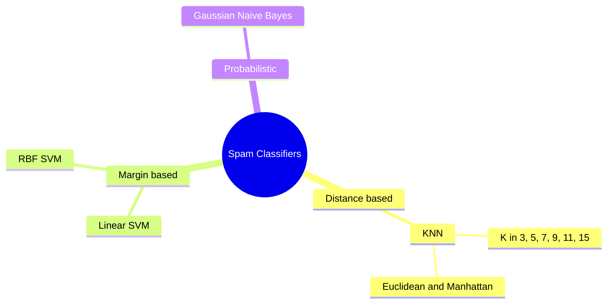
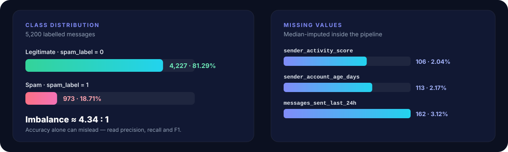
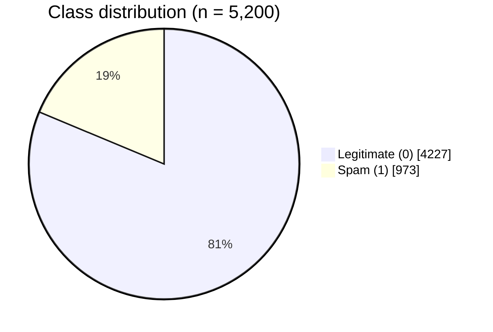
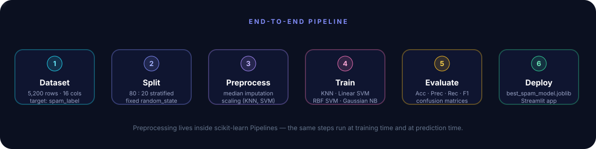
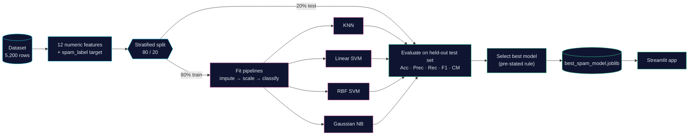
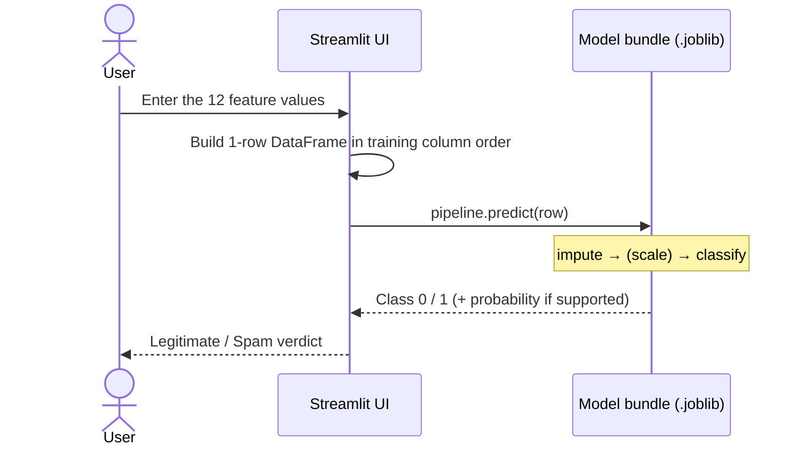

<div align="center">


<br/>

[](https://www.python.org/)
[](https://scikit-learn.org/)
[](https://streamlit.io/)
[](https://jupyter.org/)
[](https://pandas.pydata.org/)
[](https://numpy.org/)


### Is this message **legitimate** — or **spam**?
Three learning paradigms. One dataset. One honest comparison.

[**Live Demo**]([#-live-demo](https://message-intelligence-system-caoshnbr62mgxmuwxbsemm.streamlit.app/)
) · [**Dataset**](#-dataset) · [**Pipeline**](#-pipeline) · [**Models**](#-models) · [**Results**](#-results) · [**Quick Start**](#-quick-start)

</div>


## 📑 Table of Contents

<details open>
<summary><b>Jump to a section</b></summary>

1. [At a Glance](#-at-a-glance)
2. [Live Demo](#-live-demo)
3. [Objectives](#-objectives)
4. [Dataset](#-dataset)
5. [Pipeline](#-pipeline)
6. [Models](#-models)
7. [Evaluation Strategy](#-evaluation-strategy)
8. [Results](#-results)
9. [Manual Bayes' Theorem Demonstration](#-manual-bayes-theorem-demonstration)
10. [Streamlit Application](#-streamlit-application)
11. [Project Structure](#-project-structure)
12. [Quick Start](#-quick-start)
13. [Reproducibility Checklist](#-reproducibility-checklist)
14. [Limitations & Responsible Use](#-limitations--responsible-use)
15. [Roadmap](#-roadmap)
16. [Author](#-author)

</details>


## ✨ At a Glance

| | |
|---|---|
| **Problem** | Classify a message as **Legitimate (0)** or **Spam (1)** |
| **Dataset** | `Message_Intelligence_Dataset_5200` — ~5,200 records, 16 columns |
| **Target** | `spam_label` (0 = legitimate, 1 = spam) |
| **Input** | 12 engineered **numerical** features (not raw text) |
| **Models** | K-Nearest Neighbors · Linear SVM · RBF SVM · Gaussian Naive Bayes |
| **Preprocessing** | Median imputation + standard scaling (KNN / SVM) inside scikit-learn `Pipeline`s |
| **Split** | 80 : 20, stratified, fixed `random_state` |
| **Metrics** | Accuracy · Precision · Recall · F1 (spam = positive class) · Confusion matrix |
| **Interface** | Streamlit app loading `model/best_spam_model.joblib` |




## 🚀 Live Demo

<div align="center">

[](https://YOUR-APP-NAME.streamlit.app/)

</div>

> [!NOTE]
> Replace `https://YOUR-APP-NAME.streamlit.app/` with your deployed URL **only after** you have tested the link. If the app is not deployed yet, follow [Quick Start](#-quick-start) to run it locally.


## 🎯 Objectives

- [x] Understand and prepare a labelled message-classification dataset
- [x] Handle missing numerical feature values (median imputation)
- [x] Apply feature scaling where required (KNN, SVM)
- [x] Train and compare **KNN**, **SVM** (linear + RBF) and **Gaussian Naive Bayes**
- [x] Evaluate with accuracy, precision, recall and F1-score
- [x] Examine classification errors with confusion matrices
- [x] Present a trained model through a **Streamlit** application


## 📊 Dataset

<div align="center">

</div>

<br/>



| Class | Records | Share |
|---|---:|---:|
| Legitimate (0) | 4,227 | 81.29% |
| Spam (1) | 973 | 18.71% |
| **Total** | **5,200** | **100%** |

> [!IMPORTANT]
> The classes are **imbalanced** (≈ 4.34 : 1). A model that always predicts "legitimate" would already score ≈ 81% accuracy while catching **zero** spam — so accuracy alone is never enough. Precision, recall, F1 and the confusion matrix are reviewed for every model.

### Features used by the models

| Group | Feature | Description |
|---|---|---|
| ✉️ **Content** | `message_length` | Length of the message |
| | `word_count` | Number of words |
| | `num_urls` | Number of URLs |
| | `num_digits` | Number of digits |
| | `num_special_chars` | Number of special characters |
| 🔑 **Keyword signals** | `spam_keyword_score` | Spam-keyword score |
| | `legit_keyword_score` | Legitimate-keyword score |
| 👤 **Sender behaviour** | `sender_activity_score` | Sender activity score *(106 missing)* |
| | `sender_account_age_days` | Account age in days *(113 missing)* |
| | `messages_sent_last_24h` | Messages sent in the last 24 hours *(162 missing)* |
| 🕒 **Temporal** | `hour_of_day` | Hour the message was sent |
| | `day_of_week` | Day of the week |

**Deliberately excluded from model input:** the record identifier, raw message text, timestamp, and the target column (`spam_label`).

> [!NOTE]
> Because raw text is not used, the current app predicts from **engineered numerical features** — it does not analyse a pasted message directly.


## 🔄 Pipeline

<div align="center">

</div>

<br/>



### Why pipelines?

Preprocessing is bundled **inside** scikit-learn `Pipeline`s, so:

- the **same** steps run at training time and at prediction time,
- imputation medians and scaling statistics are learned **from the training data only** — reducing preprocessing leakage,
- the saved `.joblib` file contains preprocessing **and** the classifier as a single estimator.

| Model | Pipeline |
|---|---|
| **KNN** | `SimpleImputer(median)` → `StandardScaler` → `KNeighborsClassifier` |
| **Linear SVM** | `SimpleImputer(median)` → `StandardScaler` → `SVC(kernel="linear")` |
| **RBF SVM** | `SimpleImputer(median)` → `StandardScaler` → `SVC(kernel="rbf")` |
| **Gaussian NB** | `SimpleImputer(median)` → `GaussianNB` |


## 🤖 Models

| Paradigm | Model | Core idea | Strengths | Watch out for |
|---|---|---|---|---|
| 📍 Distance-based | **KNN** | Vote among the nearest training examples | Simple; captures local patterns | Sensitive to scaling, K, distance metric and data size |
| 📐 Margin-based | **Linear / RBF SVM** | Learn a maximum-margin decision boundary | Strong in high-dimensional spaces; RBF models non-linear patterns | Depends on settings and preprocessing; no probabilities unless enabled |
| 🎲 Probabilistic | **Gaussian NB** | Bayes' theorem + Gaussian feature likelihoods | Fast, compact, probability-oriented | Independence and Gaussian assumptions may not hold |

<details>
<summary><b>📍 K-Nearest Neighbors — experiment grid</b></summary>

<br/>

- **K values compared:** 3, 5, 7, 9, 11, 15
- **Distance metrics compared:** Euclidean and Manhattan
- **Scaling:** required — distance is dominated by large-range features otherwise
- **Selection rule:** choose K and metric from **validation / cross-validation** performance, *not* because they score best on the test set

</details>

<details>
<summary><b>📐 Support Vector Machines — linear vs RBF</b></summary>

<br/>

- **Linear SVM** — linear decision boundary
- **RBF SVM** — radial-basis-function kernel for non-linear boundaries
- **Support-vector counts** are reviewed to understand how each fitted model uses the training data
- `SVC` does **not** provide `predict_proba` unless `probability=True` was set at training time

</details>

<details>
<summary><b>🎲 Gaussian Naive Bayes — assumptions</b></summary>

<br/>

- Features are assumed **conditionally independent** given the class
- Each numerical feature is modelled with a **Gaussian** distribution per class
- Only median imputation is applied (scaling is not required)

</details>


## 📏 Evaluation Strategy

Spam is the **positive class (1)** for precision, recall and F1.

$$\text{Precision}=\frac{TP}{TP+FP}\qquad \text{Recall}=\frac{TP}{TP+FN}\qquad F_1=\frac{2\cdot \text{Precision}\cdot \text{Recall}}{\text{Precision}+\text{Recall}}$$

| | **Predicted legitimate** | **Predicted spam** |
|---|:---:|:---:|
| **Actually legitimate** | ✅ TN — correctly delivered | ⚠️ FP — *good message flagged as spam* |
| **Actually spam** | ❌ FN — *spam slipped through* | ✅ TP — spam caught |

| Metric | Question it answers | Why it matters here |
|---|---|---|
| **Accuracy** | How many predictions were correct overall? | Misleading on imbalanced data |
| **Precision** | Of messages flagged as spam, how many really are? | Protects legitimate messages from false alarms |
| **Recall** | Of all real spam, how much did we catch? | Keeps spam out of the inbox |
| **F1-score** | Harmonic mean of precision and recall | Balanced single number for model selection |


## 🏆 Results

> [!WARNING]
> **Final metrics have not been supplied yet.** Run the notebook, then copy the real values from its output. Do not invent numbers.

<!-- RESULTS:START -->
| Model | Accuracy | Precision (spam) | Recall (spam) | F1 (spam) |
|---|---:|---:|---:|---:|
| KNN — selected K and metric | _pending_ | _pending_ | _pending_ | _pending_ |
| Linear SVM | _pending_ | _pending_ | _pending_ | _pending_ |
| RBF SVM | _pending_ | _pending_ | _pending_ | _pending_ |
| Gaussian Naive Bayes | _pending_ | _pending_ | _pending_ | _pending_ |
<!-- RESULTS:END -->

> **Auto-fill:** after the notebook writes `output/Model_Performance_Comparison.csv`, run
> `python scripts/update_readme_results.py` to replace the table above and bold the highest-F1 row.

**Best model:** _to be determined from the measured comparison table._
Select the model with the highest measured F1-score under a pre-stated rule (for example, highest validation F1), while weighing the practical cost of **missed spam** versus **false spam alerts**.

### Confusion matrices

<table>
  <tr>
    <td align="center"><b>KNN</b><br/></td>
    <td align="center"><b>Linear SVM</b><br/></td>
  </tr>
  <tr>
    <td align="center"><b>RBF SVM</b><br/></td>
    <td align="center"><b>Gaussian Naive Bayes</b><br/></td>
  </tr>
</table>

> [!NOTE]
> Images appear after the notebook's evaluation cells run successfully and the `output/` folder is committed.

> [!CAUTION]
> A perfect score or **zero** misclassifications is **not** proof of a flawless classifier. Before reporting unusually high results, verify the train/test split, target leakage, duplicate records and the evaluation procedure.


## 🧮 Manual Bayes' Theorem Demonstration

The notebook includes a hand-computed example showing the probability reasoning behind Naive Bayes, based on whether a message contains **at least one URL**.

$$P(\text{Spam}\mid\text{URL})=\frac{P(\text{URL}\mid\text{Spam})\,P(\text{Spam})}{P(\text{URL}\mid\text{Spam})\,P(\text{Spam})+P(\text{URL}\mid\text{Legit})\,P(\text{Legit})}$$

| Ingredient | Value |
|---|---|
| Prior $P(\text{Spam})$ | 973 / 5,200 ≈ **0.1871** |
| Prior $P(\text{Legit})$ | 4,227 / 5,200 ≈ **0.8129** |
| $P(\text{URL}\mid\text{Spam})$ | _from notebook output_ |
| $P(\text{URL}\mid\text{Legit})$ | _from notebook output_ |
| **Posterior $P(\text{Spam}\mid\text{URL})$** | _from notebook output_ |

> The full Gaussian Naive Bayes model uses all selected numerical features — the URL indicator is only an illustration.


## 🖥️ Streamlit Application

The app loads the saved model bundle, collects the 12 feature values, builds an input row in the **exact training column order**, and shows the predicted class. Probability scores appear **only** when the selected estimator supports them.



The exported bundle (`model/best_spam_model.joblib`) contains the **fitted pipeline**, the **expected feature-column order**, the **model name** and the **class-label mapping**.

> [!IMPORTANT]
> **Version compatibility.** The model was trained with **scikit-learn 1.6.1** and **joblib 1.4.2**. An earlier app environment used scikit-learn 1.5.2 / joblib 1.6.0. scikit-learn does not guarantee that persisted models load across versions — pin the training versions in `requirements.txt`.


## 🗂️ Project Structure

```text
Message_Intelligence_System/
├── Message_Intelligence_Dataset_5200.csv   # source dataset (use your actual filename)
├── Message_Intelligence_System.ipynb       # analysis, preprocessing, training, evaluation, Bayes demo
├── app.py                                  # Streamlit application
├── requirements.txt                        # pinned dependencies
├── README.md
├── assets/                                 # animated SVGs used by this README
│   ├── hero.svg
│   ├── pipeline.svg
│   ├── dataset-overview.svg
│   └── divider.svg
├── scripts/
│   └── update_readme_results.py            # fills the Results table from the CSV
├── model/
│   └── best_spam_model.joblib              # fitted pipeline + metadata
└── output/                                 # generated by the notebook
    ├── KNN_Confusion_Matrix.png
    ├── SVM_Linear_Confusion_Matrix.png
    ├── SVM_RBF_Confusion_Matrix.png
    ├── Naive_Bayes_Confusion_Matrix.png
    └── Model_Performance_Comparison.csv
```

> If your notebook or dataset has a different filename, keep your actual filename rather than renaming it to match this tree.


## ⚡ Quick Start

**1 · Clone and create an environment**

```bash
git clone https://github.com/YOUR_USERNAME/Message_Intelligence_System.git
cd Message_Intelligence_System

python -m venv .venv
source .venv/bin/activate        # Windows: .venv\Scripts\activate
```

**2 · Install pinned dependencies**

```bash
pip install -r requirements.txt
```

<details>
<summary><b>Suggested <code>requirements.txt</code></b></summary>

```text
scikit-learn==1.6.1
joblib==1.4.2
streamlit
pandas
numpy
matplotlib
```

Adjust to the libraries your notebook actually imports (for example `seaborn`, `jupyter`).

</details>

**3 · Run the notebook** — executes preprocessing, training, evaluation, plots, the Bayes demo, and exports the model.

```bash
jupyter notebook Message_Intelligence_System.ipynb
```

**4 · Fill the README results table** *(optional)*

```bash
python scripts/update_readme_results.py
```

**5 · Launch the app**

```bash
streamlit run app.py
```

Enter the numerical feature values, submit the form, and review the predicted label (plus probabilities when supported).


## ✅ Reproducibility Checklist

Before submitting or publishing, confirm that:

- [ ] The notebook runs from data loading through evaluation without unresolved errors
- [ ] `output/` contains the four confusion-matrix images and the comparison CSV
- [ ] The README metric table matches the notebook output exactly
- [ ] The saved model loads in the app's Python environment (same scikit-learn / joblib versions)
- [ ] Test set was **not** used to fit preprocessing or tune model settings
- [ ] The report states the model-selection rule and the precision / recall trade-off
- [ ] The deployed app URL is added only if deployment is complete and the link works


## ⚖️ Limitations & Responsible Use

- The model uses **engineered numerical features**; it does not process raw message text.
- Dataset patterns may not represent every real-world spam campaign or legitimate communication.
- Legitimate messages outnumber spam, so metrics beyond accuracy are essential.
- Naive Bayes relies on simplifying statistical assumptions.
- KNN depends on feature scaling, K and the distance metric.
- SVM probability estimates are unavailable unless enabled at training time.
- A prediction is a **model estimate, not a guarantee** — important messages should never be rejected solely on an automated classification.
- Final metrics should come from a **held-out test set** that was not used to select or tune the model.


## 🛣️ Roadmap

Ideas for taking the project further (not yet implemented):

- [ ] Add text features (e.g. TF-IDF on the raw message) alongside the numerical ones
- [ ] Cross-validated hyper-parameter search with a clearly separated final test set
- [ ] Probability calibration for SVM (`probability=True` or `CalibratedClassifierCV`)
- [ ] Class-weighting and decision-threshold tuning for the precision / recall trade-off
- [ ] Feature-importance analysis (permutation importance)
- [ ] REST API wrapper around the exported pipeline


## 👤 Author

<div align="center">

**Roshan Marathe** — AI/ML Engineer · Surat, Gujarat, India

[](https://github.com/YOUR_USERNAME)
[](https://www.linkedin.com/in/YOUR_PROFILE)

<br/>

⭐ If this project helped you, consider giving it a star.


<sub>Built with scikit-learn · pandas · NumPy · Streamlit</sub>

</div>
